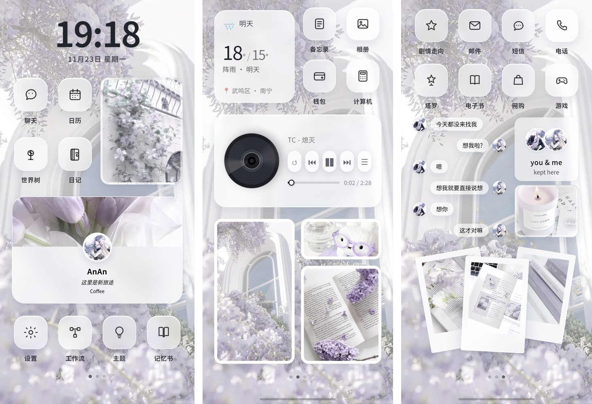

# HA star

一台装在自己手机里的小手机。

> **只想装来玩？**
>
> 不用看代码。点右边 **Releases**，下载 `HA-star-v47.3.apk`，传到手机点安装（第一次装要允许「未知来源」）。装好进「设置 → 模型接入」填自己的 Key 就能聊。
>
> 想自己改、自己编，往下看。

> **内测版提示**
>
> 这一版只能算内测版。很多功能只在作者本人的手机上跑过，换一台手机、换一个分辨率，可能出现图标摆放位置不合理、间距对不上之类的情况，需要自己手动改一改。作者这台机器上目前是稳的，暂时没遇到别的 bug。
>
> **目前小屏的手机在排版上会不兼容，建议游玩网页版。**

一个单文件的网页，外面套一层很薄的 Android 壳，就成了现在这个样子：桌面、聊天、相册、日记、塔罗、电话、商城都在这一屏里。**数据全部存在你自己的手机上，不经过任何服务器。**

## 长什么样

两套内置主题，加上塔罗页那张星空底，从左到右依次是：咖啡小熊（星星）、咖啡小熊（奶油）、塔罗。这些图都打包在网页里，重装也还在。

<p align="center">
  
</p>
### 作者实测美化 · 紫色主题

作者自己手机上跑起来的样子，从左到右是第一、二、三页。壁纸、图标、相册这些都能在「设置 → 主题」里换。

<p align="center">
  
</p>


## 它是什么

- `ha_star.html` —— 整个界面和逻辑都在这一个文件里，浏览器双击就能打开
- `app/` —— Android 壳工程（一个 Activity，约 200 行 Java），把它装成 APK
- 聊天要接大模型：在「设置 → 模型接入」里填自己的 Base URL、Key、模型名，本机直连
- 语音合成支持 MiniMax / 硅基流动 / OpenAI 兼容 / 自建 HTTP / 系统朗读
- 语音识别走「录音 → 上传 → 转写」，可选硅基流动、OpenAI、Groq、任意中转、自建地址

## 直接玩网页版（推荐，不会错位）

**在线打开**：<https://ananhsu.github.io/HA-star/>

不用下载、不用安装，手机浏览器点开就能用。第一次进要去「设置 → 模型接入」填自己的 Key。

想把文件放自己机器上跑，也可以：

1. 下载 `ha_star.html`
2. 用浏览器打开（手机、电脑都行）
3. 进「设置」填自己的 API Key

放自己电脑上想用局域网地址打开，可以：

```bash
python3 -m http.server 8893 --bind 0.0.0.0
```

然后手机访问 `http://电脑IP:8893/ha_star.html`。

## 自己编译 APK

依赖：

```bash
apt install aapt aapt2 apksigner zipalign android-sdk-platform-23
# 另外需要 JDK 17 和 r8.jar（放在 tools/r8.jar，或用 d8 替代）
```

编译：

```bash
bash app/build.sh        # 出不签名的包
bash app/build.sh sign   # 顺带签名（记得先把 build.sh 里的 keystore 路径和口令改成你自己的）
```

产物在 `build/ha_star.apk`。

壳只做四件事：把网页装进 WebView、网页要麦克风时向系统申请并放行、网页要选文件时拉系统选择器、返回键先回网页上一页。想加功能（通知、分享、常驻后台）都从这个壳里改。

## 关于数据

聊天记录、图片、设置全部存在你手机本地（浏览器 localStorage / WebView 存储），没有服务器在背后收着。换手机、清缓存之前请先在设置里导出备份。

## 许可

**免费使用，可以二次修改，不许拿去商用。** 详见 [LICENSE](LICENSE)。想商用请先联系作者。

## 联系

作者：[AnAnHsu](https://github.com/AnAnHsu) · QQ 2047916805

---

这个项目是一时兴起，跟家机一块搓出来的小手机，目前功能不是很多。如果它帮到你了，给个 star。
